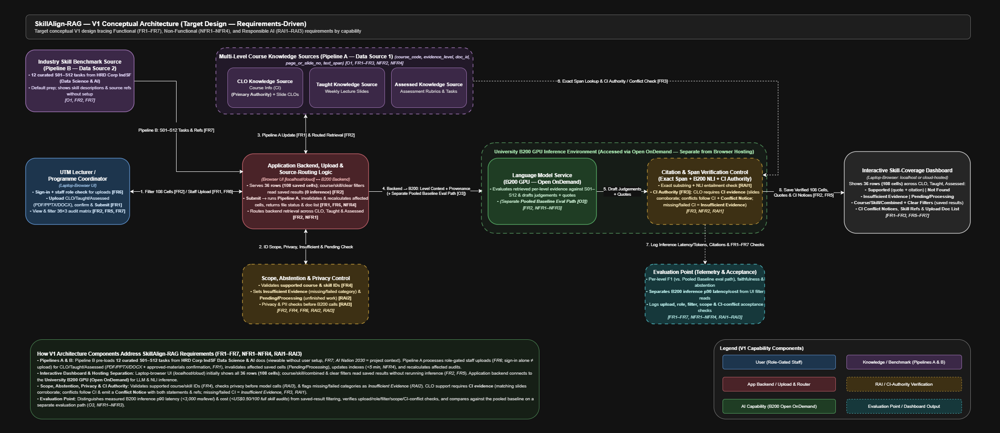

# V1 Architecture Decisions, Trade-offs, and Traceability — SkillAlignRAG

**Save in:** `docs/week2_architecture_decisions.md`

The diagram below describes the revised V1 target architecture, including
approved staff uploads, the default IndSF benchmark, the interactive dashboard,
and university B200 inference accessed through Open OnDemand. It represents the
planned design; implementation status is tracked separately in
[implementation status](implementation_status.md).

## 1\. Architecture Needs Derived from Requirements 

| Requirement ID | What does the requirement need? | Architecture Response (V1 Capability Component) |
| :---- | :---- | :---- |
| **FR1 / FR2 / NFR2 / NFR4** | Course evidence must be ingested, updated, and retrieved separately across **CLO** (CI PDFs), **Taught** (lecture slides), and **Assessed** (rubrics) levels with exact page/slide provenance (`course_code`, `evidence_level`, `doc_id`, `page_or_slide_no`, `text_span`) without mixed-file context dilution. | **Multi-Level Course Knowledge Sources** (`CLO`, `Taught`, and `Assessed` stores) paired with **Application Interface & Source-Routing Logic** |
| **FR3 / RAI1** | Every **Supported** judgement must include a verifiable verbatim text span (`100%` presence) and an entailment-verified source citation (`≥ 95%` faithfulness; `≤ 5%` unsupported claims). CI governs CLO decisions; matching slide statements may only corroborate CI, and conflicts must be displayed with both source references. | **Citation & Span Verification Control** (post-generation deterministic substring check \+ semantic entailment verification) with **CI Authority and Conflict Reporting** |
| **FR2 / FR4 / RAI2 / RAI3** | Missing or wholly unprocessable categories must produce **Insufficient Evidence**, unfinished audits must remain Pending/Processing, unsupported course/skill selections must be rejected (`100%` of prepared cases), and confidential exam keys/PII must not leak externally (`0` leaks). | **Scope, Abstention & Privacy Control** with course/skill allowlists; no free-text query interface in V1 |
| **O3 / NFR1 / NFR2 / NFR3** | End-to-end latency (`p90 < 3,000 ms/level`), token expenditure (`< US$0.50 / 100 queries`), per-level F1 (`≥ 0.80`), and citation faithfulness metrics must be systematically recorded across benchmark workloads. | **Evaluation Point** \+ efficient routing path through **Language Model Service** |
| **FR2 / FR3 / FR5** | Academic staff need an interactive, side-by-side overview of 36 course–skill rows and 108 CLO/Taught/Assessed cells, course/skill filters, and inspectable citations for CQI review. | **Interactive Skill-Coverage Dashboard** |
| **FR1 / FR6** | Approved academic staff need category-based PDF/PPTX/DOCX uploads, automatic processing after submission, per-file feedback, and a course/category document list. Upload access must be enforced in the interface and backend, with an approved-materials declaration separate from role approval. | **Sign-In and Role Authorisation** \+ **Category Upload Interface** \+ **Pipeline A** |
| **FR7** | Users must see the 12 predefined skills and their HRD Corp IndSF source references without uploading industry documents or configuring the benchmark. | **Preconfigured Industry Source and Pipeline B** \+ **Visible Benchmark Catalogue** |

---

## 2\. Architecture Decision Record (ADR) 

| Decision | Requirement / Constraint | Alternatives Considered | Selected Option | Trade-off Accepted |
| :---- | :---- | :---- | :---- | :---- |
| **ADR 1: Partition knowledge access into source-routed multi-level stores (`CLO`, `Taught`, `Assessed`)** | **FR1, FR2, NFR2, NFR4:** Must prevent mixed-file context dilution, achieve Macro-F1 ≥ 0.80 across all 3 constructive-alignment levels, and allow incremental single-level updates in \< 5 min. | 1\. Base language model only (no retrieval) 2\. Single pooled knowledge source (conventional single-pass RAG) 3\. Source-routed multi-level knowledge sources (`CLO`, `Taught`, `Assessed`) | **Multi-Level Course Knowledge Sources** with explicit **Source-Routing Logic** | Increased orchestration complexity and 3 separate retrieval calls per full course audit, accepted in exchange for higher per-level recall/F1, strict level provenance, and isolated index updates (\< 5 min). |
| **ADR 2: Add an explicit post-generation Citation & Span Verification Control** | **FR3, RAI1:** Must guarantee 100% verbatim span presence, ≥ 95% citation faithfulness, and ≤ 5% unsupported-claim rate on **Supported** judgements. | 1\. Prompt instructions only (relying on LLM self-citation) 2\. Post-generation LLM-as-a-Judge critique 3\. Explicit **Citation & Span Verification Control** (deterministic substring match \+ semantic entailment check) | **Explicit Citation & Span Verification Control** | Additional verification latency (`NFR1`) and risk of conservative false-negative rejections when evidence is fragmented across slide bullets, accepted to eliminate hallucinated quotes and ensure audit-grade provenance. |
| **ADR 3: Include explicit Scope, Abstention & Privacy Control** | **FR2, FR4, RAI2, RAI3:** Must distinguish missing/failed processing from processed-but-unsupported evidence, reject unsupported course/skill selections (100% of prepared cases), and prevent external leakage of PII or unpublished exam keys (0 transmissions). | 1\. Prompt-level instructions only 2\. Explicit **Scope, Abstention & Privacy Control** checking supported identifiers, processing state, payload privacy, and document availability | **Explicit Scope, Abstention & Privacy Control**, with a fixed-selection dashboard and no free-text query interface | Restricts V1 to the curated courses and skills; requires processing-state tracking and backend validation as well as interface controls. |
| **ADR 4: Integrate a dedicated Evaluation Point for telemetry and benchmark auditing** | **O3, NFR1, NFR2, NFR3, RAI1, RAI2:** Must measure per-level F1 vs. single-pass RAG baseline, citation faithfulness, p90 latency (\< 3,000 ms/level), and cost (\< US\$0.50 / 100 queries). | 1\. Manual ad-hoc inspection of final outputs 2\. Dedicated **Evaluation Point** capturing structured runtime, token, prediction, and verification logs | **Dedicated Evaluation Point** | Slight logging and storage overhead during execution, accepted to ensure reproducible empirical evaluation against the single-pass RAG baseline. |
| **ADR 5: Separate staff uploads from dashboard review** | **FR1, FR2, FR5, FR6, FR7:** Approved staff submit category-based files; reviewers inspect predefined skills and saved audit results. | 1. Folder/CLI workflow only 2. Interface with server-enforced upload roles, processing-state tracking, and saved audit results | **Authorised Uploads and Interactive Dashboard**, backed by Pipeline A/B and an audit coordinator | Adds account/role management and result-state persistence; avoids rerunning inference for filter changes. Staff confirmation of acceptable content does not automatically detect student submissions. |
| **ADR 6: Require CI authority before slide corroboration** | **FR3 / RAI1:** A usable CI file alone does not establish that a slide CLO agrees with it. | 1. CI-first ranking with unrestricted auxiliary slide support 2. CI-backed CLO decisions with explicit slide comparison | **CI Authority and Conflict Reporting** in addition to existing span/NLI gates | Requires matching corresponding statements and recording both sources; slide-only outcomes cannot establish CLO support, and missing/failed CI remains Insufficient Evidence. |

---

## 3\. Initial Requirements Traceability Matrix

| Objective | Requirement | Evaluation Criterion | Architecture Element | Later Evidence |
| :---- | :---- | :---- | :---- | :---- |
| **O1** | **FR1, FR3, FR5, NFR4** | Provenance Schema Completeness; Interactive Audit and Evidence Inspection | **Multi-Level Course Knowledge Sources** \+ **Interactive Skill-Coverage Dashboard** | 100% provenance completeness/correctness on prepared fixtures, required dashboard elements present, 100% successful Supported-cell evidence inspections, and incremental update test (\< 5 min). |
| **O2** | **FR3, RAI1** | Source Citation Faithfulness and Verbatim Support | **Citation & Span Verification Control** | Evaluation benchmark audit confirming 100% verbatim span presence, ≥ 95% NLI citation faithfulness, and ≤ 5% unsupported-claim rate on **Supported** outputs. |
| **O1, O2** | **FR2, FR4, RAI2, RAI3** | Missing-Evidence Abstention and Audit-State Clarity; Supported Audit Scope Enforcement | **Scope, Abstention & Privacy Control** \+ **Application Interface & Source-Routing Logic** | 100% correct handling of missing, failed, processed-without-evidence, and unfinished cases; 100% rejection of at least 20 unsupported selection attempts; no excluded task features; payload privacy audit (0 leaks). |
| **O1, O2** | **FR1, FR2, FR6, FR7** | Category Upload and Processing Feedback; Academic-Staff Upload Access Control; Predefined Industry-Skill Benchmark Visibility; Full Audit Overview and Filtering | **Sign-In and Role Authorisation** \+ **Category Upload Interface** \+ **Pipeline A / Pipeline B** \+ **Interactive Skill-Coverage Dashboard** | Upload/format/declaration tests, interface and backend role tests, all 12 predefined skills visible with correct source details and no setup, and correct default/filtered/restored dashboard rows. |
| **O2** | **FR3, RAI1** | CI Authority and Corroborating Slide Evidence | **Citation & Span Verification Control** \+ **CI Authority and Conflict Reporting** | Prepared matching/conflicting/slide-only/missing-CI cases satisfy the CI authority policy, corroboration labels, conflict notices, and Insufficient Evidence behavior. |
| **O3** | **FR2, NFR2** | Multi-Level Skill-Coverage Classification Correctness | **Application Interface & Source-Routing Logic** \+ **Multi-Level Course Knowledge Sources** \+ **Language Model Service** | Comparative benchmark evaluation table reporting per-level Precision, Recall, and Macro-F1 (≥ 0.80) and positive F1 gain over the single-pass RAG baseline. |
| **O3** | **NFR1, NFR3** | Response Latency and Token Cost Efficiency | **Language Model Service** \+ **Evaluation Point** | Benchmark telemetry logs demonstrating p90 latency \< 3,000 ms per evidence-level query (\< 9,000 ms per full 3-level audit) and inference cost \< US\$0.50 per 100 queries. |

---

## 4\. Final V1 Architecture Review Checklist 

- [x] **Does each major component support a requirement or evaluation need?** Yes—every component beyond the base flow maps directly to `FR1–FR7`, `NFR1–NFR4`, or `RAI1–RAI3` (verified in Section 1 and Section 3 above).
- [x] **Is any important data source, safety control, or evaluation point missing from the target design?** The target tables include all three evidence categories, default IndSF sources, approved staff access, upload processing, the dashboard, both RAI controls, CI authority handling, and evaluation. The updated diagram represents these capabilities; implementation is tracked separately.
- [x] **Have I added any technology or component that is not yet justified?** No—components are labeled strictly by capability/function at V1 without premature lock-in to specific vector databases, LLM weights, or UI frameworks.  
- [x] **Is there a simpler architecture that could still satisfy the requirements?** No—a simpler unrouted single-pass RAG flow without deterministic verification and missing-file checks fails `FR2`, `FR3`, `NFR2`, `NFR4`, `RAI1`, and `RAI2`.
